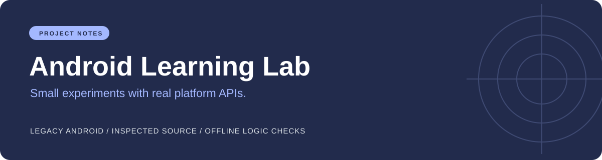

# Android Learning Lab

A collection of small C# and XML Android exercises from a legacy Xamarin project. Source previously available only inside `Ofek_Ventura_Android.zip` is now reviewable in `Android_Ofek/`, excluding IDE state and build outputs. The ZIP remains a historical snapshot; use the extracted project for current code changes.

## Real contents

Activity source includes calculator, accelerometer, camera, list view, dialogs, permission handling, music service, intent examples, and tic-tac-toe. These are educational examples, not independently verified production features. The login/register sample stores password strings in SharedPreferences; it is not secure authentication and must not handle real credentials.

## Calculator fixes and local demonstration

`CalcActivity.cs` no longer dereferences a null number when decimal is the first input, and starts that input as `0.`. Its arithmetic uses the new production `CalculatorMath.cs`, which accepts invariant decimal input, rejects incomplete/invalid numbers and unsupported operations, and rejects division by zero and nonfinite results. Invalid calculations show a message while retaining the input.

Run `dotnet run --project checks/LogicChecks.csproj` with .NET SDK 10. It directly compiles production arithmetic and checks all four operations, a decimal-comma device culture, incomplete decimals, zero division, NaN, and overflow. This is a console logic demonstration, not a captured Android UI run.

## Build status and safe use

The extracted legacy project build was attempted on 2026-10-01 and failed with MSB4019 because `Xamarin.Android.CSharp.targets` is missing. No Android emulator or device run was performed. A legacy compatible toolchain or deliberate migration is needed before UI verification. Inspect camera, SMS, phone and intent examples before running; use an isolated emulator with synthetic inputs and do not send messages or place calls.

## Positioning

Keep as an Android learning archive. It is useful evidence of platform API breadth, with no claim of maintained authentication or release readiness. Suggested repository name: `android-learning-lab`. No license or remote name was changed.
